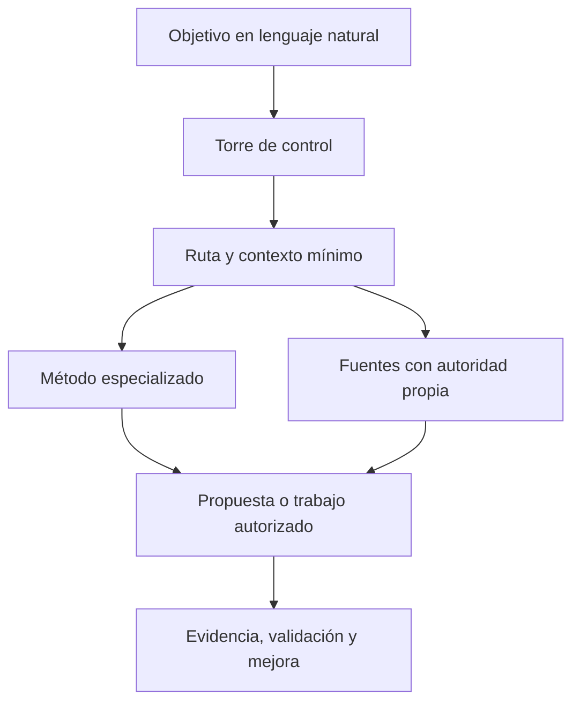

# Personal AI System — Public Showcase

**Una torre de control para trabajar con inteligencia artificial sin perder contexto, fuentes ni control.**

[Caso de estudio en el portfolio](https://franvitar.genovasite.com/work/personal-ai-system?lang=es) · [English version](docs/README.en.md) · [Mapa técnico completo](docs/system-map.md) · [Arquitectura](docs/architecture.md) · [Flujos de punta a punta](docs/workflows.md) · [Decisiones de ingeniería](docs/engineering-decisions.md) · [Seguridad y alcance](docs/security-and-scope.md) · [Guía para recruiters](docs/recruiter-tour.md)


> **Alcance honesto:** este repositorio contiene una **implementación pública de referencia, escrita con datos sintéticos**. Se inspira en las decisiones de arquitectura de Personal AI System (PAS), pero **no es el sistema personal completo**, no comparte su historial Git y no se conecta a cuentas, datos ni herramientas privadas. Se publica para que cualquier persona pueda leer, ejecutar y evaluar código representativo. No hay demo web ni servicio público.

**La complejidad también es parte de la historia.** La primera referencia mostraba seis rutas simples; esta versión agrega una segunda capa técnica, auditable, que conserva la amplitud conceptual: **14 Skills**, routing de conocimiento y aislamiento, políticas de permisos, evidencia por claim, aprendizaje y captura, continuidad con CAS, mejora gobernada y el catálogo profesional de **12 servicios × 7 intervenciones × 35 familias de diseño**. Esas cifras describen **contratos y catálogo**, no 14 agentes instalados ni 35 librerías desplegadas.

## Evolución V2 (en desarrollo)

[PAS Explorer — arquitectura, diseño y aceptación](docs/PAS_EXPLORER_V2_ARCHITECTURE.md) · [Checkpoint de implementación](docs/PAS_EXPLORER_V2_CHECKPOINT.md). La primera interfaz de desarrollo está en [explorer/](explorer/README.md): nueve vistas bilingües que ejecutan módulos públicos con datos ficticios, sin conexiones privadas. Todavía no está desplegada ni pasó QA visual de navegador.

## El problema

Cuando un asistente de IA participa en tareas de estudio, investigación, desarrollo de software o gestión personal, la conversación por sí sola no alcanza:

- El contexto cambia y una conversación vieja puede quedar desactualizada.
- Una respuesta convincente no demuestra que una operación realmente ocurrió.
- Distintas herramientas son dueñas de distintas fuentes de verdad.
- Leer información no equivale a tener permiso para modificarla.
- El conocimiento reutilizable no debería mezclarse con datos sensibles o estados temporales.

**PAS organiza ese trabajo como un sistema:** recibe un objetivo, determina qué método corresponde, recupera fuentes pertinentes, aplica límites de autorización y busca evidencia del resultado.

## Cómo se organiza



En el sistema privado, **GitHub** conserva metodología, conocimiento depurado, scripts y reglas; **Drive y otras fuentes autorizadas** conservan originales, registros y estado de sus dominios. **ChatGPT puede ser una interfaz conversacional**, pero no reemplaza esas fuentes ni constituye prueba de una escritura. La implementación pública usa un registro de fuentes completamente ficticio. El [mapa técnico](docs/system-map.md) separa lo **documentado**, lo **ejecutable en esta referencia** y lo **operativo solo en el sistema privado**.

### Un sistema, varios ámbitos

| Ámbito | Qué resuelve PAS | Cómo aparece en este repositorio |
| --- | --- | --- |
| Aprendizaje y universidad | Método adaptativo según materia, temario y evaluación | Ruta `study`, fuentes de materia y pasos de práctica |
| Entrenamiento y nutrición | Captura estructurada de lo informado y separación de fuentes | Rutas `training` y `nutrition`; propuestas sin escritura automática |
| Investigación y conocimiento | Contexto selectivo, trazabilidad y revisión de evidencia | Ruta `research`, selección explícita de fuentes |
| Proyectos | Continuidad a partir de estado autorizado | Ruta `projects`, fuentes de proyecto |
| Trabajo profesional | Método específico, alcance, investigación y criterios de aceptación | Ruta `professional` y su método de referencia |
| Seguridad y calidad | Permisos, fallos explícitos, idempotencia y readback | `ControlTower`, `SyntheticStore` y tests |

Esta tabla describe **áreas de arquitectura**, no seis aplicaciones desplegadas. El sistema también contempla dominios como inglés, finanzas, compras, series, inteligencia profesional, planificación, conocimiento curado y mejora continua. La [matriz de cobertura ampliada](docs/system-map.md) muestra esas responsabilidades sin ocultarlas por razones de marketing.

## Código que vale la pena revisar

1. [`src/catalog.mjs`](src/catalog.mjs): router transparente entre métodos, con rutas explícitas.
2. [`src/source-registry.mjs`](src/source-registry.mjs): separación entre fuentes canónicas, disponibilidad y contexto requerido.
3. [`src/context-compiler.mjs`](src/context-compiler.mjs): selección limitada por dominio/proyecto, excluyendo conocimiento superado y contextos ajenos.
4. [`src/control-tower.mjs`](src/control-tower.mjs): plan de lectura versus propuesta de escritura, validaciones y aprobación.
5. [`src/synthetic-store.mjs`](src/synthetic-store.mjs): persistencia **solo en memoria**, idempotencia y comprobación por recibo.
6. [`test/control-tower.test.mjs`](test/control-tower.test.mjs): casos positivos y negativos observables, incluido rechazo ante fuente faltante o plan falsificado.

### Segunda capa: complejidad de sistema

7. [`src/reference/skill-registry.mjs`](src/reference/skill-registry.mjs): inventario de los 14 contratos de Skill y composición por intención.
8. [`src/reference/knowledge-runtime.mjs`](src/reference/knowledge-runtime.mjs): packs candidatos, selección, niveles de contexto, aislamiento, fuente y *fetch policy*.
9. [`src/reference/policy-engine.mjs`](src/reference/policy-engine.mjs) y [`evidence-runtime.mjs`](src/reference/evidence-runtime.mjs): permisos, frontera de confianza, riesgo, autoridad y estados de evidencia.
10. [`src/reference/study-runtime.mjs`](src/reference/study-runtime.mjs) y [`capture-runtime.mjs`](src/reference/capture-runtime.mjs): decisiones de estudio y captura de hechos sin inferencias silenciosas.
11. [`src/reference/project-ledger.mjs`](src/reference/project-ledger.mjs): continuidad multiproyecto con aislamiento, CAS, idempotencia y readback.
12. [`src/reference/professional-delivery.mjs`](src/reference/professional-delivery.mjs) y [`improvement-runtime.mjs`](src/reference/improvement-runtime.mjs): delivery con 12/7/35, research-first y mejora basada en evaluación.
13. [`src/reference/orchestrator.mjs`](src/reference/orchestrator.mjs): traza compuesta que conecta todas las fronteras anteriores, sin efectos externos.
14. [`test/reference-runtime.test.mjs`](test/reference-runtime.test.mjs): pruebas del enrutamiento, aislamiento, permisos, concurrencia, evidencia y límites.

**Decisión central:** una respuesta generada, un plan y una escritura verificada son estados diferentes. El ejemplo no los presenta como equivalentes.

## Ejecutar y verificar

Necesitás **Node.js 20+**; no hay dependencias externas ni credenciales.

```bash
npm run check
npm test
npm run example
npm run tour
```

`example` muestra el recorrido inicial de control y captura. `tour` recorre **inventario arquitectónico, control→Skills→contexto→política→evidencia, captura, aprendizaje, continuidad y mejora**. Los tests verifican rutas, aislamiento, fail-closed, límites de aprobación, validación de registros, reintentos, CAS y readback. [Ver matriz de verificación](docs/verification.md).

El workflow [`CI`](.github/workflows/ci.yml) ejecuta el chequeo y los tests en GitHub Actions. Consultá la pestaña Actions para ver el estado real de la última ejecución; este README no presupone una corrida remota aprobada.

## Qué es privado y qué es público

| PAS real (privado) | Showcase (público) |
| --- | --- |
| Conocimiento, decisiones, proyectos y reglas vigentes | Contratos didácticos y escenarios inventados |
| Fuentes y conectores autorizados según dominio | Fuentes sintéticas en memoria |
| Métodos y evaluaciones con mayor profundidad | Router inicial más 10 módulos de referencia/contratos; sin paridad de implementación |
| Permisos efectivos según entorno y herramienta | Aprobación explícita dentro de una simulación local |
| Datos de uso, historial y evidencia personales | Tests reproducibles sin datos personales |

No se incluyen secretos, prompts privados, tokens, conectores reales, material de materias, datos de salud, proyectos de clientes ni exportaciones del repositorio original.

## Enfoque de ingeniería

- **Separación de responsabilidades:** routing, selección de fuentes, compilación de contexto, política de escritura y almacenamiento están desacoplados.
- **Fail closed:** si una fuente obligatoria no está, el flujo no inventa un resultado.
- **Mínimo privilegio:** la ruta de estudio nunca se convierte silenciosamente en permiso de escritura.
- **Aprobación y readback:** una captura necesita una confirmación, una clave de idempotencia y una comprobación posterior.
- **Evidencia antes que marketing:** tests y límites identificables, sin inventar métricas de producción.

Para el razonamiento detrás de estas decisiones y lo que **no** prueba el ejemplo, ver [decisiones](docs/engineering-decisions.md) y [límites de seguridad](docs/security-and-scope.md).

---

**Francisco Vitar** · Ingeniería en Sistemas · IA aplicada, arquitectura de software y productos digitales.

Este repositorio es *source-available* para revisión técnica. No se agregó una licencia de reutilización del código; esa elección es independiente de que GitHub permita leerlo públicamente.
