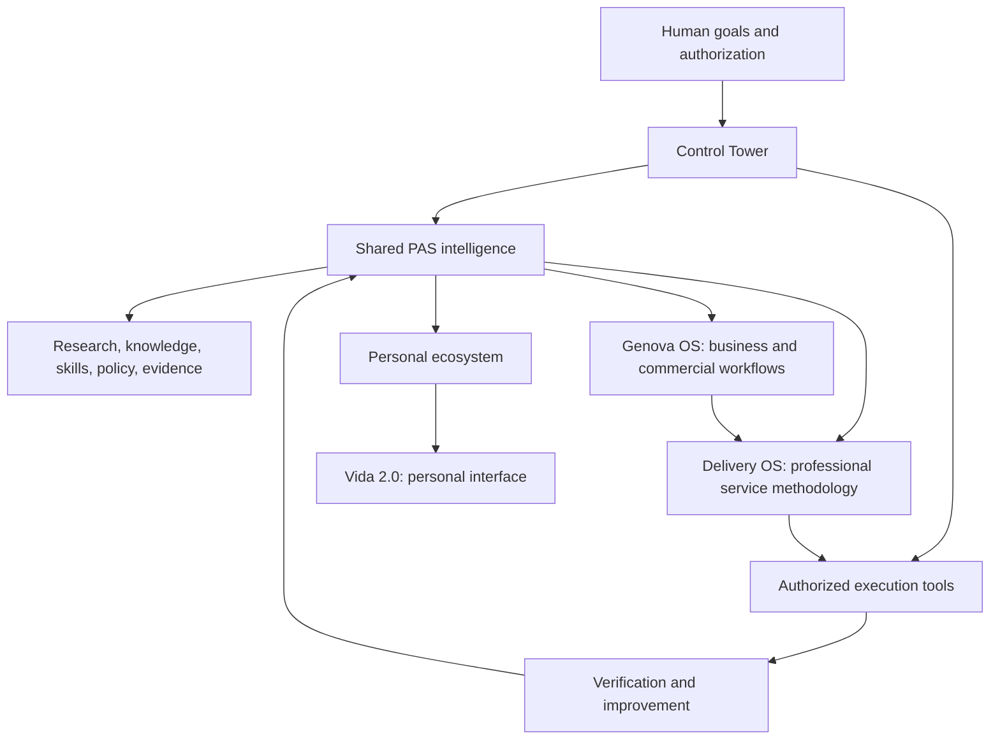

# PAS Showcase V2 · PAS Explorer
Status: approved product direction, implementation started — 2026-11-24.
This is an independently authored public reference, not the private PAS, an export of its history, or an operational Genova service.

## Goal
Give recruiters three connected surfaces: a bilingual portfolio case, an interactive browser sandbox that runs the public modules, and this inspectable code/test repository. Preserve existing public reference APIs and documentation unless a change is justified.

## Architecture

The arrows are responsibilities, not deployed integrations. Separate the private operational architecture, the executable public reference, and proposed future work. No private source links, customer records, original knowledge corpus, connector credentials or proprietary prompts.

## Product design
- Portfolio: flagship PAS card, overview in one minute, expandable architecture and maturity, knowledge hierarchy, research, business and delivery, execution and evidence, three guided scenarios, direct links to reference source and Explorer.
- Explorer: bilingual, keyboard-accessible responsive UI, existing restrained portfolio style; overview, routing trace, context inclusion/exclusion, research comparison, Delivery catalog, commercial pipeline, execution checkpoint and evidence panels. Clearly mark fictional examples and unsupported/blocked states. A task cannot become complete merely by clicking an unrelated visual control.
- Build Explorer as a browser-only static app importing the same public pure modules used in tests. No LLM calls, external writes, secret-bearing backend, database, login or new paid infrastructure. Session state in memory, resettable; no cross-visitor state.
- Reuse the existing public reference (Control Tower, source registry, knowledge, policy, evidence, study, capture, ledger, improvement). Add narrow modules, no forced folder migration.
- Delivery retains 12 services, 7 interventions, 45 compatible routes, 35 candidate family identities; contextual selection is not a whitelist. A selected family is not a loaded dossier or validated implementation. Distinguish professional V1 from future integration V2.
- Commercial Engine and Content Studio remain candidate methods; Genova OS as a whole is partially implemented privately. Public business scenarios are separate fictional logic, never contact outreach or customer changes.
- Long Execution is a bounded planning and checkpoint model, not a promise of continuous unattended AI execution. Human tasks grouped; local blockers stop dependents, global blockers stop all. Tool evaluation must account for capability, risk, authority and budget; unknown cost or permissions cannot authorize execution.
- Knowledge: GLOBAL / DOMAIN / PROJECT / SUBJECT, private preferences isolated; Biblioteca 360 and Delivery family catalog have distinct responsibilities. Evidence states separate claims, source authority, tests, and observed outcomes. No promotion on generation alone.

## Milestones (proposed engineering acceptance; not a canonical personal progress record)
1. Architecture and initial logic (20): versioned design; compatibility and contextual selection; dependency planner and revision checkpoints; positive/negative tests authored and run in supported runtime.
2. Broader reference (25): research/evidence, tool evaluation, commercial lifecycle, knowledge ownership; deterministic synthetic examples and negative tests.
3. Explorer (25): real module-backed guided journeys, no effects outside browser, reset, responsive and keyboard navigation, bilingual copy.
4. QA and docs (20): native Node full suite, browser core paths and negatives, privacy review, source/readme/run instructions and no inflated claims.
5. Portfolio/release (10): coherent bilingual case and links, explicit release authorization, one bounded verified deployment on existing cost allowance; no production claims.

## Acceptance
One visitor can inspect a synthetic request, classify/select compatible service and candidates, see why a source is excluded, complete a permitted synthetic checkpoint, see rejected or blocked actions and resume independent work. Test isolation, invalid routes, invalid revisions/permissions, missing evidence, global and local blockers. No network side effects. Document any component not demonstrated. Release only after actual test and privacy review, with zero additional spend ceiling; if hosting cannot be verified at that cost, keep a runnable local/static fallback.

## First slice
The new public route matrix and candidate selector are derived from the confirmed catalog dimensions, with independently authored illustrative selection rules. The pure execution planner validates the dependency graph, separates ready AI/human tasks, and accepts synthetic checkpoint events only at the expected revision with correct actor and fixture evidence. It does not authenticate a human, verify an external evidence artifact, execute agents or persist anything outside memory. The existing source receipt is an example contract, not a live GitHub verification. Further public modules, Explorer UI and final portfolio changes remain pending.
