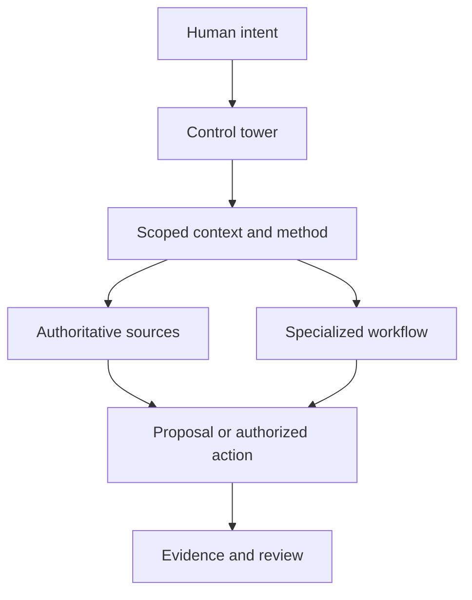

# Personal AI System — Public Showcase

**An AI control tower designed to preserve context, source authority and human control across long-running work.**

[Portfolio case study](https://franvitar.genovasite.com/work/personal-ai-system) · [Español](../README.md) · [Architecture](architecture.md) · [Engineering decisions](engineering-decisions.md) · [Security & scope](security-and-scope.md) · [Recruiter review guide](recruiter-tour.md)

> This is a **separate, synthetic reference implementation** of selected Personal AI System architectural ideas. It is **not** a copy of the private system, a deployed service, an LLM model, or a live connector. Its code and tests are intentionally open for technical review.

## The challenge

AI assistants can help with research, learning, software engineering and personal operations. But a single conversation is not a durable source of truth. A generated response is not evidence that an operation happened, and the ability to read a tool does not imply permission to write to it.

PAS approaches those problems with explicit routing, scoped retrieval, domain-specific methods, source ownership, authorization boundaries and verification steps.



In the **private PAS**, GitHub holds curated knowledge, skills and governance; Drive and other authorized systems retain their own domain records or originals. ChatGPT can serve as a conversational interface, not as the database or a substitute for verification. This public implementation replaces all such integrations with synthetic metadata and in-memory behavior.

## Architecture covered here

| Area | Reference workflow | Key concept |
| --- | --- | --- |
| Adaptive learning | `study` | Subject sources and assessment-oriented workflow |
| Training | `training` | Structured capture as a gated proposal |
| Nutrition | `nutrition` | Reported information, without invented data |
| Research | `research` | Scoped knowledge and evidence references |
| Professional delivery | `professional` | Task-specific method and acceptance steps |
| Projects | `projects` | Project continuity from an explicit source |

These are **representative flows**, not complete products or faithful exports of private modules.

## Review the actual code

- [`src/catalog.mjs`](../src/catalog.mjs): readable domain routing.
- [`src/source-registry.mjs`](../src/source-registry.mjs): source availability and minimal retrieval.
- [`src/context-compiler.mjs`](../src/context-compiler.mjs): bounded, scope-isolated synthetic context selection.
- [`src/control-tower.mjs`](../src/control-tower.mjs): the boundary between a plan, a write proposal and an authorized synthetic write.
- [`src/synthetic-store.mjs`](../src/synthetic-store.mjs): idempotency and readback in memory.
- [`test/control-tower.test.mjs`](../test/control-tower.test.mjs): failure paths, misuse and safe retries.

Run with Node.js 20+ (no credentials or dependencies):

```bash
npm run check
npm test
npm run example
```

The example has **no web UI**. Code and automated tests are the public evidence, while the actual PAS remains private. The [security document](security-and-scope.md) distinguishes simulated guards from real authentication, integrations and production operation.

**Francisco Vitar** · Systems Engineering · Applied AI and software architecture.
