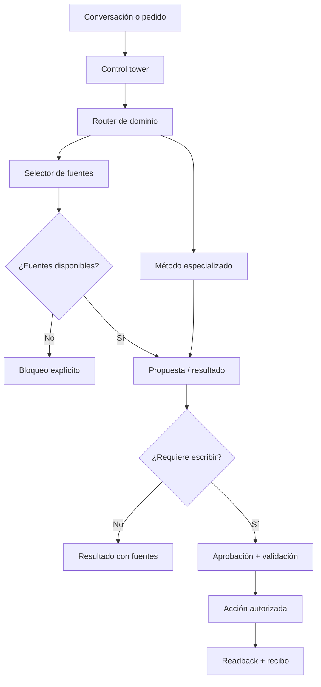

# Architecture / Arquitectura

> Model conceptual público, no diagrama de despliegue del PAS privado.

## Límites de responsabilidad

1. **Interfaz.** En el sistema personal, una conversación puede iniciar el pedido. Este repositorio comienza con una cadena de texto, sin ChatGPT API ni credenciales.
2. **Control.** `routeIntent()` identifica uno de seis métodos de ejemplo. No pretende replicar el enrutamiento avanzado ni los perfiles privados.
3. **Conocimiento.** `resolveSources()` retorna únicamente fuentes necesarias, con roles y versiones ficticios. No hay búsqueda en un repositorio privado.
4. **Ejecución.** `plan()` no ejecuta escrituras. Incluso `training` y `nutrition` terminan como `PROPOSE_ONLY`.
5. **Autorización.** `applySyntheticWrite()` requiere un plan emitido por esa instancia, aprobación, clave de idempotencia y registro validado.
6. **Evidencia.** La única operación mutante escribe en memoria y devuelve un recibo comprobado con lectura posterior.

## Posibles escenarios y sus pruebas

| Solicitud ficticia | Ruta | Fuentes requeridas | Resultado público |
| --- | --- | --- | --- |
| "Preparar mi parcial de Redes" | `study` | Blueprint + material de curso | Plan de lectura, sin puntajes inventados |
| "Hoy entrené en el gimnasio" | `training` | Registro de entrenamiento | Propuesta; autorización antes de append sintético |
| "Hoy comí una manzana" | `nutrition` | Registro nutricional | Datos informados, sin calcular calorías ficticias |
| "Investigar alternativas" | `research` | Pack + referencias | Selección de fuente; no simula navegación real |
| "Remodelar una web" | `professional` | Método + contexto | Ruta y pasos; no inicia un proyecto de cliente |
| "Continuemos el proyecto" | `projects` | Estado de proyecto | Plan con fuente identificada; sin persistencia remota |

## Diferencia fundamental con una aplicación monolítica

En PAS, cada dominio conserva sus reglas y su autoridad. El sistema no necesita convertirse en otra base de datos universal. El punto de integración es **cómo se toma una decisión respaldada por fuentes y permisos**, no copiar toda la información en un chat o repositorio público.

Ver [engineering decisions](engineering-decisions.md) para trade-offs y [security & scope](security-and-scope.md) para límites.
