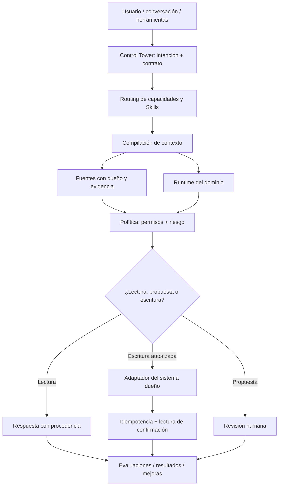
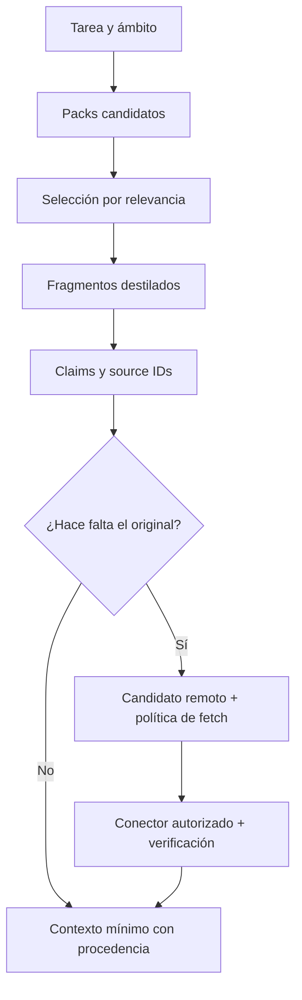

# Mapa técnico de PAS / Technical system map

> **Alcance:** mapa arquitectónico del sistema privado, reconstruido con contratos y ejemplos sintéticos. No es una exportación del repo original ni una afirmación de paridad funcional. La implementación pública está dividida entre **código de referencia ejecutable**, **catálogo de contratos** y **arquitectura documentada**.

## 1. Arquitectura por capas

Las flechas muestran **responsabilidades y fronteras de confianza**, no procesos ya desplegados en el showcase. Los adaptadores reales pertenecen a cada sistema dueño y **no están incluidos**.

## 2. Cobertura visible, sin inflar lo implementado

| Capa del PAS real | Dónde verla acá | Cobertura pública | Qué permanece privado o externo |
| --- | --- | --- | --- |
| Control Tower y contratos de tareas | `src/control-tower.mjs`, `src/reference/orchestrator.mjs` | Ejecución sintética con traza | Selección real de herramientas/sesiones |
| 14 Skills de orquestación y dominio | `src/reference/skill-registry.mjs` | 14 contratos declarativos; selección de stack | Instrucciones, recursos y automatizaciones privadas |
| Routing de packs y compilación V4 | `src/reference/knowledge-runtime.mjs` | Router y retrieval deterministas con ámbitos | Índice FTS5/BM25 real, corpus, heurísticas especializadas |
| Knowledge scope GLOBAL/DOMAIN/PROJECT/SUBJECT/PERSONAL | `knowledge-runtime.mjs`, `context-compiler.mjs` | Aislamiento GLOBAL/DOMAIN/PROJECT/SUBJECT probado | Preferencias personales reales; estado de materias |
| Gobernanza de conocimiento y fuentes | `src/reference/evidence-runtime.mjs` | Elegibilidad por autoridad A–D, riesgo, freshness y locator | Curation real, fuentes registradas, verificación online |
| Fuente canónica vs original vs estado | `src/source-registry.mjs`, `docs/architecture.md` | Roles de fuente y fail-closed | Repos privados, Drive y otros originales |
| Autorización, privacidad y seguridad | `src/reference/policy-engine.mjs` | Reglas de referencia, separación plan/ejecución | Identidad real, scopes OAuth, vault, políticas por proveedor |
| Captura conversacional | `src/reference/capture-runtime.mjs` | No inferir campos; propuesta validada | Interpretación LLM real, conectores canónicos |
| Aprendizaje adaptativo y examen | `src/reference/study-runtime.mjs` | Blueprint, facetas, un ítem a la vez, sin readiness ficticia | Learning runtime integral, FSRS, material oficial |
| Continuidad multiproyecto | `src/reference/project-ledger.mjs` | CAS, owner isolation, recibo e idempotencia en memoria | Registro durable, autenticación y reconciliación remota |
| Trabajo profesional / Genova | `src/reference/professional-delivery.mjs` | 12 servicios, 7 intervenciones, 35 familias de investigación/selección; gates | Investigación por encargo, bibliotecas implementadas, ejecución y validación real |
| Mejora continua del sistema | `src/reference/improvement-runtime.mjs` | Baseline, riesgo, evidencia, regresiones y adopción separada | Métricas de operación, revisión mantenida, cambios reales |
| QA / evaluaciones | `test/`, `.github/workflows/ci.yml` | Tests reproducibles de caminos felices y negativos | Evaluaciones de producción, incidentes, SLAs |

**Tres estados que no se mezclan:** `DOCUMENTADO` ≠ `REFERENCIA_EJECUTABLE` ≠ `OPERACIONAL_REAL`. Un test verde en este repositorio demuestra un comportamiento de *esta referencia*, nunca un conector de PAS privado, la certificación integral de Genova V1 ni las automatizaciones de V2.

## 3. Skills: alcance completo del inventario arquitectónico

El registro público conserva 14 capacidades distintivas:

| Transversales / gobierno | Aprendizaje | Dominios y trabajo |
| --- | --- | --- |
| context-compilation | adaptive-learning | conversational-capture |
| knowledge-curation | study-session | gym-intelligence |
| system-maintenance | assignment-execution | nutrition-intelligence |
| long-execution (opt-in) | generalist-learning | football-intelligence-analyst |
| project-session-closeout | | genova-delivery |

No son 14 agentes autónomos siempre activos. Una petición selecciona el método necesario y opcionalmente capacidades transversales; las demás quedan fuera de contexto.

## 4. Ámbitos y productos especializados

PAS tiene proyectos especializados que superan las seis rutas visibles de la primera versión del showcase. La arquitectura contempla, entre otros:

| Grupo | Ejemplos de proyectos/ámbitos del sistema |
| --- | --- |
| Aprendizaje e investigación | Universidad, inglés, Learning OS, investigación del mundo, biblioteca de conocimiento, inteligencia profesional |
| Salud y hábitos | Gym Intelligence, Nutrition Intelligence, foco, rutinas y planificación |
| Vida personal | Vida 2.0, tareas, proyectos, finanzas, compras, películas y series, YouTube |
| Trabajo y entrega | Genova Delivery OS, Genova OS, trabajo web, búsqueda laboral, perfil profesional |
| Herramientas transversales | Captura universal, mejora continua, gestión del estado y los proyectos |
| Otros análisis | Football Intelligence Analyst como capacidad específica del sistema, **sin convertirla en producto destacado del portfolio** |

Cada ámbito puede tener su propia fuente de verdad, flujo, alcance, permisos y evaluaciones. Esta lista es **cobertura documental de responsabilidades**, no una afirmación de que cada producto tenga implementación equivalente en el repo público.

## 5. Fuentes, recuperación y frescura

En el código público, la ruta llega a **candidatos remotos con `fetched: false`**. No descarga originales. Diferencia además *autoridad* (apropiada a la afirmación), *frescura* (cambios de versión/tiempo), *precisión de procedencia*, *sensibilidad* y *estado canónico*. El origen físico (Drive, GitHub, web) no determina el ámbito del conocimiento.

## 6. Genova: amplitud no equivale a disponibilidad

- **12 servicios:** web, software, rediseño, modernización, ecommerce, automatización, IA, integraciones, SEO, Google Ads, mantenimiento y analítica; identificadores en `SERVICES`.
- **7 intervenciones:** `CREATE`, `REDESIGN`, `AUDIT`, `IMPROVE`, `MIGRATE`, `REPAIR`, `MAINTAIN`. Se eligen independientemente del servicio.
- **35 familias L01–L35:** diseño/UX, motion, ingeniería, marketing/medición y metodología/QA. Están **habilitadas bajo demanda para investigar y seleccionar en V1**, no son 35 paquetes instalados ni 35 implementaciones certificadas.
- **V1 (alcance objetivo):** metodología profesional completa sobre 12 servicios, 7 intervenciones y 35 familias: discovery, Research First, entregables, QA con evidencia, handoff y continuidad multiproyecto; ChatGPT IA coordina, y Codex/Drive/GitHub intervienen solo con la autoridad correspondiente. **No se declara V1 íntegramente certificada ni validada en campo.**
- **V2 (meta técnica posterior):** MCP/OAuth, conectores, orquestación hospedada, persistencia automática y observabilidad. No significa que las 35 familias profesionales deban esperar hasta V2. Algunos archivos del PAS original conservan el sufijo histórico `_V2`, pero su contenido metodológico participa del alcance V1.

`designDeliveryPlan()` exige un recibo de fuente marcado como verificado y siempre devuelve `executionAuthority: NONE`. El caller no gana permisos por pasar un booleano de aprobación; el ejemplo no tiene ejecutor real.

## 7. Qué no demostramos

La calidad de recomendaciones reales, la cobertura de todas las materias, la exactitud de un modelo LLM, sincronizaciones de salud, despliegues, conectores autenticados, durabilidad entre reinicios, servicios de cliente y producción. Para esos límites, ver [Seguridad](security-and-scope.md) y [Evidencia de tests](verification.md).

## Public reference extension — PAS Explorer V2

| Responsibility | Executable public module | Boundary |
| --- | --- | --- |
| Intent and scoped browser trace | `src/reference/browser-trace.mjs` | Synthetic registry and claims; no LLM or remote reads |
| Research coverage and counterevidence | `src/reference/research-review.mjs` | Fixture provenance, no live fact checking or winner |
| Tool evaluation | `src/reference/tool-comparison.mjs` | Matched fixture metrics, eligibility and Pareto comparison; not vendor pricing |
| Work blocks | `src/reference/execution-block.mjs` | Dependency, local/global blockers, revision and reconciliation; no real agents |
| Delivery selection | `src/reference/delivery-selection.mjs` | 45 compatible routes; candidate selection, not private dossier retrieval |
| Commercial workflow | `src/reference/commercial-case.mjs` | Fictional lifecycle, consent and suppression; not real CRM or contact |
| Browser interface | `explorer/` | Nine views, in-memory fixtures, no external execution or shared persistence |

The public reference is not equivalent to field validation of Genova V1, adoption of commercial candidate methods, or a live V2 host. See [architecture and acceptance](PAS_EXPLORER_V2_ARCHITECTURE.md) and [current checkpoint](PAS_EXPLORER_V2_CHECKPOINT.md).
